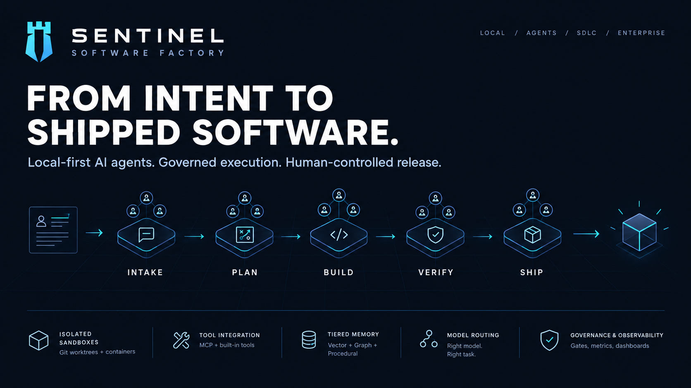
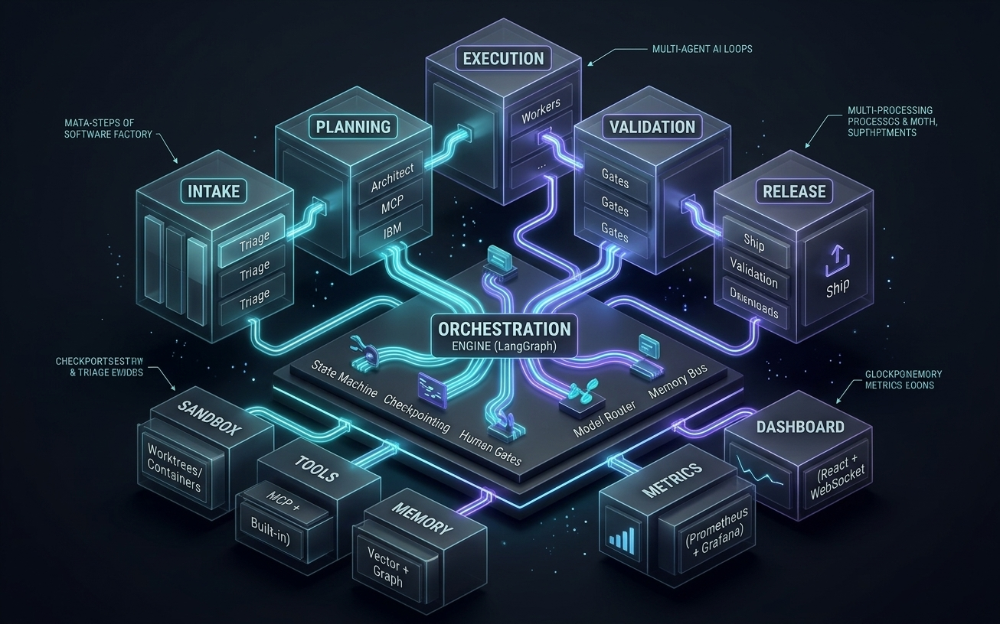
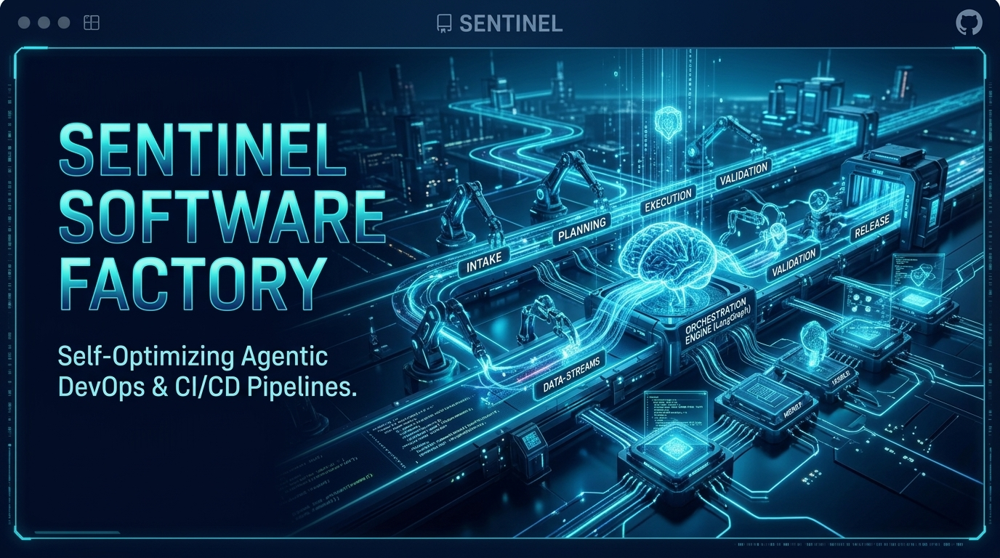
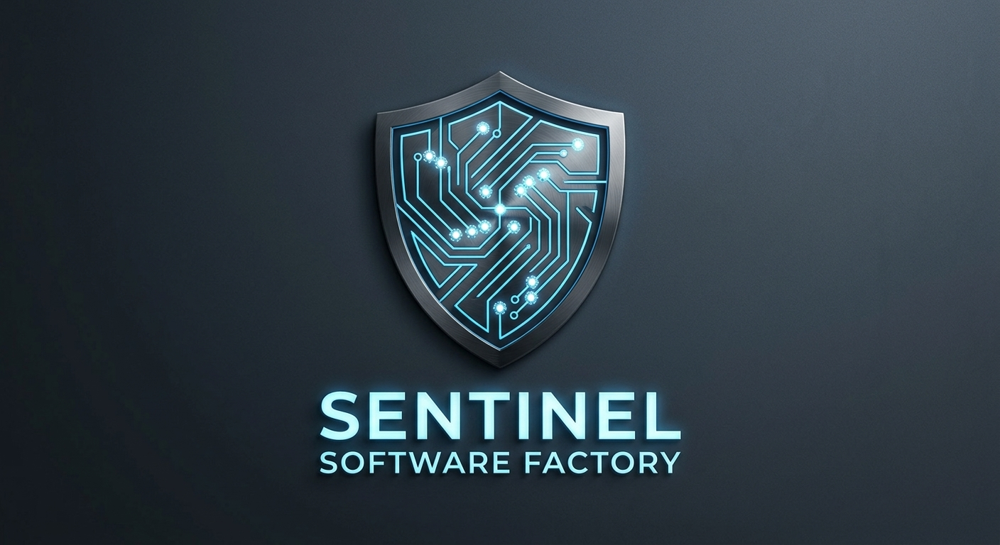

<div align="center">


# 🛡️ Sentinel Software Factory

**From intent to shipped software.**

Local-first AI agents. Governed execution. Human-controlled release.



**Plan.** · **Build.** · **Verify.** · **Ship.**

[](LICENSE)
[](https://www.python.org/downloads/)
[](https://github.com/langchain-ai/langgraph)
[](https://www.docker.com/)
[](https://modelcontextprotocol.io/)

</div>

---

## 🏗️ Architecture & Agent Pipeline

Sentinel Software Factory coordinates autonomous agent loops across six deterministic SDLC stages:

| Stage | Agent | Responsibility | Key Patterns |
|-------|-------|----------------|--------------|
| **1. Intake (Triage)** | `TriageAgent` | Work classification, deduplication, intent routing | Routing, Reflection |
| **2. Planning (Architect)** | `ArchitectAgent` | Technical specs, system context, task decomposition | Planning, Prompt Chaining |
| **3. Execution (Worker Pool)** | `WorkerPoolAgent` | Parallelized implementation in isolated sandboxes | Multi-Agent, Parallelization, Tool Use |
| **4. Validation (Gates)** | `CodeReviewAgent` + `QAAgent` + `SecurityAgent` | Dual-LLM code review, unit tests, security scans | Guardrails, Human-in-the-Loop, Reflection |
| **5. Release (Ship)** | `ReleaseAgent` | Deployment orchestration, smoke testing, rollback | Prioritization, Monitoring |
| **6. Documentation** | `DocumenterAgent` | AutoWiki, ADRs, changelogs, API docs | Learning, Exploration |
| **7. Monitor** | `MonitorAgent` | Incident correlation, auto-remediation, effectiveness tracking | Learning, Evaluation |

```
┌─────────────────────────────────────────────────────────────────────────────────┐
│                    SENTINEL SOFTWARE FACTORY (Local-First)                       │
├─────────────────────────────────────────────────────────────────────────────────┤
│                                                                                  │
│  ┌─────────────┐  ┌─────────────┐  ┌─────────────┐  ┌─────────────┐  ┌────────┐  │
│  │   INTAKE    │  │  PLANNING   │  │ EXECUTION   │  │ VALIDATION  │  │ RELEASE│  │
│  │  (Triage)   │──│ (Architect) │──│ (Workers)   │──│  (Gates)    │──│ (Ship) │  │
│  └─────────────┘  └─────────────┘  └─────────────┘  └─────────────┘  └────────┘  │
│        │                │                │                │                │        │
│        └───────────────┼────────────────┼────────────────┼────────────────┘        │
│                        ▼                ▼                ▼                         │
│  ┌─────────────────────────────────────────────────────────────────────────────┐   │
│  │              ORCHESTRATION ENGINE (LangGraph)                                │   │
│  │  State Machine • Checkpointing • Human Gates • Model Router • Memory Bus    │   │
│  └─────────────────────────────────────────────────────────────────────────────┘   │
│                        │                │                │                         │
│         ┌──────────────┼──────────────┼──────────────┼──────────────┐              │
│         ▼              ▼              ▼              ▼              ▼              │
│  ┌────────────┐ ┌────────────┐ ┌────────────┐ ┌────────────┐ ┌────────────┐      │
│  │  SANDBOX   │ │   TOOLS    │ │   MEMORY   │ │  METRICS   │ │  DASHBOARD │      │
│  │ (Worktrees/│ │  (MCP +    │ │ (Vector +  │ │ (Prometheus│ │  (React +  │      │
│  │ Containers)│ │  Built-in) │ │  Graph +   │ │  + Grafana)│ │  WebSocket)│      │
│  └────────────┘ └────────────┘ └────────────┘ └────────────┘ └────────────┘      │
│                                                                                  │
└─────────────────────────────────────────────────────────────────────────────────┘
```

---

## ✨ Core Capabilities

### 🔒 Local-First by Design
Runs entirely on your machine or self-hosted — no cloud dependency. You own the models, the data, and the execution environment.

### 🤖 Multi-Agent Orchestration (LangGraph)
Production-grade state machine with checkpointing, human-in-the-loop gates, and model routing. Built on LangGraph for reliable, resumable execution.

### 🏗️ Isolated Sandboxes
Git worktrees + Docker containers per task. Full isolation for parallel execution, safe tool use, and reproducible builds.

### 🧠 Tiered Memory System
- **Working** (Redis): Active task context, sub-hour TTL
- **Episodic** (ChromaDB): Conversation history, decisions, 30-day retention
- **Semantic** (Neo4j): Architecture decisions, code patterns, permanent knowledge graph
- **Procedural** (Templates): Versioned skills, workflows, best practices

### 🔌 MCP Integration
Model Context Protocol for standardized tool connectivity. Progressive tool discovery keeps context lean.

### 📊 Real-Time Observability
React dashboard with WebSocket live updates. Prometheus + Grafana for historical metrics. Per-agent cost tracking.

### 🛡️ Governance & Safety
Risk-tiered repositories, command allow/deny lists, human approval gates, dual-LLM review for high-risk changes. Secrets never enter agent context.

### 💰 Transparent Cost Tracking
Per-model, per-agent, per-run token and USD cost accounting. Model routing optimizes for cost/quality.

---

## 🚀 Quick Start

### Prerequisites
- Docker & Docker Compose
- Anthropic API key (for Claude models) — [Get one here](https://console.anthropic.com/)
- Optional: Ollama for local models

### 1. Clone & Configure
```bash
git clone https://github.com/omermindivanli/sentinel-software-factory.git
cd sentinel-software-factory

# Copy environment template
cp .env.example .env

# Edit .env with your API keys
# ANTHROPIC_API_KEY=your_key_here
```

### 2. Start the Factory
```bash
# Development mode (hot reload)
./scripts/setup.sh

# Or manually with Docker Compose
docker-compose -f docker-compose.yml -f docker-compose.dev.yml up -d
```

### 3. Access the Dashboard
| Service | URL | Credentials |
|---------|-----|-------------|
| **Dashboard** | http://localhost:5173 | — |
| **API** | http://localhost:8000 | — |
| **API Docs** | http://localhost:8000/docs | — |
| **Prometheus** | http://localhost:9090 | — |
| **Grafana** | http://localhost:3000 | admin / factory123 |

### 4. Create Your First Run
```bash
# Via CLI
factory run "Add user authentication" "Implement JWT with refresh tokens" --repo myorg/myapp --priority high

# Or via Dashboard UI at http://localhost:5173
# Click "New Run" → Fill form → Submit
```

The factory will execute the full pipeline: **Triage → Planning → Execution → Validation → Release → Document → Monitor**

---

## 🖥️ Dashboard Preview

<div align="center">

| Overview | Run Details | Stage Metrics |
|:--------:|:-----------:|:-------------:|
|  |  |  |

*Live agent thought stream · Stage progress · Gate results · Sandbox status · Real-time metrics*

</div>

---

## 📖 Documentation

- [Architecture](docs/architecture.md) — Detailed system architecture
- [Getting Started](docs/getting-started.md) — Step-by-step tutorial
- [Configuration](docs/configuration.md) — All configuration options
- [Agent Guide](docs/agent-guide.md) — Creating custom agents
- [Dashboard Guide](docs/dashboard-guide.md) — Dashboard features
- [Security Audit](SECURITY_AUDIT.md) — Security assessment report

---

## ⚙️ Configuration

### Models (`factory/config/models.yaml`)
```yaml
router:
  default_provider: anthropic
  fallback_provider: ollama
  models:
    - id: claude-opus-4
      provider: anthropic
      capabilities: [planning, architecture, complex_reasoning]
      api_key_env: ANTHROPIC_API_KEY
    - id: llama-3.1-8b
      provider: ollama
      local: true
      capabilities: [simple_tasks, embeddings]
```

### Stages (`factory/config/stages.yaml`)
```yaml
stages:
  - id: triage
    agent: triage
    parallelism: 1
    human_gate: false
    gates: [pre_execution]
  - id: execution
    agent: worker_pool
    parallelism: 5
    gates: [code_quality, tests, security]
```

### Governance (`factory/config/governance.yaml`)
```yaml
risk_tiers:
  - name: high
    repos: ["payments-*", "auth-*", "prod-*"]
    gates: [code_quality, tests, security, review, performance]
    human_approval: true
    max_autonomy: guided
    require_dual_llm: true
```

---

## 🤖 Extending the Factory

### Adding a Custom Agent
```python
# factory/agents/my_agent.py
from factory.agents.base import BaseAgent
from langchain_core.tools import tool

@tool
async def my_custom_tool(input: str) -> str:
    """Description of what this tool does."""
    return f"Processed: {input}"

class MyAgent(BaseAgent):
    def __init__(self, **kwargs):
        tools = [my_custom_tool]
        super().__init__(
            name="my-agent",
            agent_type="custom",
            system_prompt="You are a specialized agent...",
            tools=tools,
            **kwargs
        )
    
    async def execute(self, state: FactoryState) -> FactoryState:
        return await self.run_react_loop(state, "Your task prompt")

# Register in factory/agents/__init__.py
AGENT_REGISTRY["custom"] = MyAgent
```

### Adding a Quality Gate
```python
from factory.validation.gates import ValidationGate, GateResult

class CustomGate(ValidationGate):
    def __init__(self):
        super().__init__("custom_gate", "Custom Gate", blocking=True)
    
    async def evaluate(self, state: FactoryState) -> GateResult:
        # Your validation logic
        return GateResult(gate_id="custom_gate", name="Custom Gate", passed=True, score=1.0)

# Register
get_gate_registry().register(CustomGate())
```

### Adding an MCP Server
```yaml
# factory/config/settings.py (mcp.servers)
mcp:
  servers:
    my_server:
      command: "npx"
      args: ["-y", "@modelcontextprotocol/server-mytool"]
      env:
        MY_API_KEY: "${MY_API_KEY}"
```

---

## 📊 Monitoring & Metrics

### Key Prometheus Metrics
| Metric | Description |
|--------|-------------|
| `factory_runs_total` | Total runs by status/repository |
| `factory_stage_throughput_total` | Items processed per stage |
| `factory_stage_pass_rate` | Gate pass rates per stage |
| `factory_agent_cost_total` | Cost in USD by agent/model |
| `factory_agent_tokens_total` | Token usage by agent/model |
| `factory_stage_cycle_time_seconds` | Stage duration histogram |

### Grafana Dashboards
Pre-built dashboards in `monitoring/grafana/dashboards/`:
- **Factory Overview** — Run health, stage metrics, cost tracking
- **Stage Health** — Throughput, pass rates, cycle times
- **Agent Performance** — Latency, token usage, cost per agent
- **Cost Analysis** — Model routing efficiency, budget tracking

---

## 🧪 Testing

```bash
# Unit tests
pytest tests/unit -v

# Integration tests
pytest tests/integration -v

# With coverage
pytest --cov=factory tests/
```

---

## 📁 Project Structure

```
sentinel-software-factory/
├── SECURITY_AUDIT.md          # Security assessment
├── SPEC.md                    # Full technical specification
├── docker-compose.yml         # Production stack
├── docker-compose.dev.yml     # Development with hot reload
├── pyproject.toml             # Python dependencies
├── assets/                    # Brand assets (logo, hero)
├── factory/
│   ├── config/                # Models, stages, governance
│   ├── orchestration/         # LangGraph engine, state, checkpoints
│   ├── agents/                # 7 specialized SDLC agents
│   ├── sandbox/               # Worktree + Docker management
│   ├── tools/                 # Built-in tools + MCP client
│   ├── memory/                # Vector, graph, KV stores
│   ├── validation/            # Quality gates
│   ├── dashboard/             # FastAPI + WebSocket backend
│   └── cli/                   # Typer CLI
├── dashboard-frontend/        # React + TypeScript + Vite
├── monitoring/                # Prometheus + Grafana configs
├── tests/                     # Unit + integration tests
└── docs/                      # Documentation
```

---

## 🤝 Contributing

1. Fork the repository
2. Create a feature branch
3. Make your changes
4. Run tests: `pytest`
5. Submit a PR

See [CONTRIBUTING.md](CONTRIBUTING.md) for detailed guidelines.

---

## 📄 License

MIT License — see [LICENSE](LICENSE) for details.

---

## 🙏 Acknowledgments

- **Factory.com** — Stage model, metrics, dashboard concepts
- **Agentic Design Patterns** (Antonio Gulli) — 21 patterns implementation
- **Anthropic Research** — Building Effective Agents, Think Tool, MCP
- **LangGraph** — Production-grade orchestration
- **MCP Spec** — Progressive discovery, security best practices

---

## 🆘 Support

- **GitHub Issues** — Bug reports and feature requests
- **Discussions** — Architecture questions and community support
- **Documentation** — Comprehensive guides in `/docs`

---

<div align="center">

**Built with precision. Governed by design.**

*Sentinel Software Factory — From intent to shipped software.*

</div>